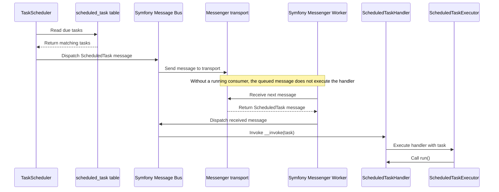

---
nav:
  title: Scheduled Task
  position: 100

---

# Scheduled Task

## What are scheduled tasks?

Scheduled tasks are a way to schedule messages to the queue on time.
Shopware uses it to run cleanup tasks, update tasks, and other non-time critical tasks in the background.

## Default scheduled tasks

These tasks are registered by default:

| Name                                | Run interval (seconds) |
| ----------------------------------- | ---------------------- |
| log_entry.cleanup                   | 86400                  |
| shopware.invalidate_cache           | 20                     |
| app_update                          | 86400                  |
| app_delete                          | 86400                  |
| version.cleanup                     | 86400                  |
| webhook_event_log.cleanup           | 86400                  |
| sales_channel_context.cleanup       | 86400                  |
| product_keyword_dictionary.cleanup  | 604800                 |
| product_download.media.cleanup      | 2628000                |
| delete_newsletter_recipient_task    | 86400                  |
| product_stream.mapping.update       | 86400                  |
| product_export_generate_task        | 60                     |
| import_export_file.cleanup          | 86400                  |
| shopware.sitemap_generate           | 86400                  |
| cart.cleanup                        | 86400                  |
| shopware.elasticsearch.create.alias | 300                    |
| translation.update                  | 86400                  |

::: info
Some tasks like `shopware.elasticsearch.create.alias` and `shopware.invalidate_cache` only run when necessary. The Elasticsearch task only runs when an Elasticsearch server is configured and enabled. The `translation.update` task only does work when at least one translation is installed through the [built-in translation handling](../../../concepts/framework/translations/built-in-translation-system.md). For details on that task, see [Automated translation updates](../../../concepts/framework/translations/automated-translation-updates.md).
:::

## Creating a scheduled task

<PageRef page="../../plugins/plugins/plugin-fundamentals/add-scheduled-task" />

::: info
The following commands or flags (--no-wait) are available starting with Shopware 6.5.5.0.
:::

## List all scheduled tasks

You can list all scheduled tasks with `bin/console scheduled-task:list` command.

## Scheduling a scheduled task

::: info
Available starting with Shopware 6.7.2.0.
:::

You can schedule a scheduled task with the command `bin/console scheduled-task:schedule`.

## Deactivating a scheduled task

::: info
Available starting with Shopware 6.7.2.0.
:::

You can deactivate a scheduled task with the command `bin/console scheduled-task:deactivate`.

## Running scheduled tasks

To run the scheduled tasks, you must set up a background worker like the [Message Queue](message-queue.md) and run the command `bin/console scheduled-task:run`. The command schedules all tasks to the queue and waits until a task needs to be scheduled. It consumes little CPU time or memory.

You can use the flag `--no-wait` and run the command from an operating system scheduler like cron. Check your scheduled task interval to determine the best interval to trigger the command. Example:

```bash
*/5 * * * * /usr/bin/php /var/www/html/bin/console scheduled-task:run --no-wait
```

## Missed runs and recovery

The scheduler and the task execution are separate steps. `scheduled-task:run` selects due tasks, sets their status to `queued` and dispatches one message per task to the message bus. The task handler runs when a message consumer handles that message, see [Message Queue](message-queue.md). The following sections describe what the `TaskScheduler` and the `ScheduledTaskExecutor` do when scheduling or message consumption was interrupted.

This sequence shows how `TaskScheduler` dispatches a due task through the message bus and transport, then how `Symfony Messenger Worker` delivers it through the bus to `ScheduledTaskHandler`, which passes it to `ScheduledTaskExecutor` to call `run()`.



### When the scheduler was not running

`TaskScheduler` selects every row of `scheduled_task` whose `nextExecutionTime` is in the past and whose status is `scheduled` or `skipped`. A task that became overdue during downtime is therefore selected on the first pass after the scheduler runs again. For each selected row that reaches the dispatch step, a pass dispatches one task message, rather than one message per missed interval. The successful queuing branch updates the status without changing `nextExecutionTime`.

The scheduler attempts to process each selected row at most once per pass; an exception can stop the pass before later rows are processed. For each row:

* If the class is unavailable to the process running `TaskScheduler`, for example because that scheduler process is running an older deployment, it logs a warning and leaves the row unchanged.
* If the class is not a `ScheduledTask`, a `MessageQueueException` is thrown.
* If `shouldRun()` of the task class returns `false`, the row gets the status `skipped` and a new `nextExecutionTime`, and no message is dispatched.

`scheduled-task:run` repeats this in a loop and sleeps between 1 and 15 seconds after each pass. With `--no-wait` it runs a single pass and exits. Configured time and memory limits and cached restart requests are checked between passes, after sleeping; they do not interrupt an ongoing pass. A restart request stops the loop when its timestamp is newer than the process startup time.

### After a task has run

For a task message with an ID, successful default rescheduling sets the status to `scheduled` and stores `lastExecutionTime` and `nextExecutionTime`. The legacy override described below controls its own persistence. By default, the new `nextExecutionTime` is the previous `nextExecutionTime` plus `runInterval`. If that is earlier than the current time, the current time is stored instead. Missed intervals are therefore not replayed one by one. If a task is overdue by more than one interval, the stored `nextExecutionTime` is the finish time, so the task is selected again on the next scheduler pass.

* If the handler implements `DynamicallyScheduledTaskHandler`, a non-null time returned by `getNextExecutionTime()` is used and clamped to the current time if it lies in the past. Returning `null` uses the default calculation: the previous `nextExecutionTime` plus `runInterval`.
* In 6.7, when the `v6.8.0.0` feature flag is inactive and the handler does not implement `DynamicallyScheduledTaskHandler`, the executor honors an override of the deprecated `rescheduleTask()` hook; that override is responsible for persisting the schedule.
* If run() throws and the task's `shouldRescheduleOnFailure()` returns true, the executor logs the error and attempts to reschedule the task. If rescheduling succeeds, it returns without throwing the original error again. The default of `shouldRescheduleOnFailure()` is `false`; then the status is set to `failed` and the exception is rethrown. The scheduler does not select rows with status `failed`.

### When the worker was not running

When a consumer handles a message, the outcome depends on the message. For messages carrying a task ID, the executor runs the task only if the row exists and its status is `queued`, `failed`, `skipped` or `running`. Messages without a task ID run independently of the stored schedule. If the row has the status `scheduled` when the message is handled, the handler does not run.

The scheduler selects a row in status `queued` or `running` again only when its `updatedAt` is older than `shopware.messenger.scheduled_task.requeue_timeout` hours. The default is `12`. A selected stale row goes through the same class and `shouldRun()` checks before another dispatch is attempted. `TaskScheduler` does not cancel or remove any earlier message. Avoid overlapping scheduler invocations: selecting a row and changing its status are separate operations, so concurrent passes can select the same row.

### Checking and recovering

`bin/console scheduled-task:list` shows the next execution, the last execution, the run interval and the status of every task. A recent last execution time does not prove success: rescheduling after a failure also updates this value when `shouldRescheduleOnFailure()` returns `true`.

`bin/console scheduled-task:schedule <task-name>` sets the status to `scheduled`. With `--immediately`, it also sets `nextExecutionTime` to the current time. Once that time is in the past, the row is eligible for selection; the normal class and `shouldRun()` checks still apply. For rows in status `queued` or `running`, the command stops with a warning unless `--force` is passed. Without `--immediately`, `nextExecutionTime` is not changed.

The following command schedules the `log_entry.cleanup` task with `--immediately`:

```bash
bin/console scheduled-task:schedule log_entry.cleanup --immediately
```

Before forcing recovery, check for existing messages and running work. This command changes the stored schedule; it does not stop an executing handler or remove existing messages. An existing message handled while the row is `scheduled` does not run the handler.

`bin/console scheduled-task:run-single <task-name>` runs a single task directly, see [Debugging scheduled tasks](#debugging-scheduled-tasks). The run-single command changes the stored status and next execution time before invoking a matching handler. It requires a `ScheduledTaskHandler` with a class-level `AsMessageHandler` attribute whose `handles` value matches the task class; without a match, no handler is invoked.

### Symfony scheduler

With `messenger:consume scheduler_shopware`, the schedule is built from `RecurringMessage::every()` with the stored `run_interval` or, without a row, the default interval of the task. The platform source doesn't specify how many runs fire after downtime.

## Using the symfony scheduler to run tasks

::: info
Running tasks with the symfony scheduler is available starting with Shopware 6.6
:::

::: warning
This feature is experimental.
:::

You can run scheduled tasks as part of your queue workers with the help of the symfony scheduler component.

``` bash
bin/console messenger:consume scheduler_shopware
```

On startup of this command reads the `scheduled_task` database table and applies the stored intervals, an entry in this table is optional. In the event that these intervals are modified in the database, it is necessary to restart the command for the updated intervals to take effect.
To deactivate tasks, set status to `Shopware\Core\Framework\MessageQueue\ScheduledTask\ScheduledTaskDefinition::STATUS_INACTIVE` in this table, and restart the `consume` command.

<!--@include: ../../../snippets/guide/debugging_scheduled_tasks.md-->
