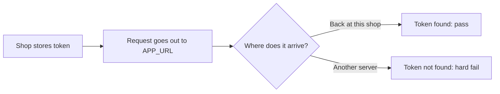

---
nav:
  title: APP_URL Verification
  position: 42

---

# APP_URL Verification

## Overview

Before Shopware registers the shop with an app server, it verifies that `APP_URL` leads back to this installation.
A wrong `APP_URL` would otherwise give the app server the address of another shop, for example the live shop on a staging copy, or of no shop at all.
If the verification fails, Shopware does not contact the app server.

::: info
This page is for shop operators.
For the registration protocol on the app side, see [App Registration & Backend Setup](app-registration-setup.md).
:::

## How the verification works

1. Shopware creates a random token and stores it in the `cache.app_url_verification` cache pool for two minutes.
2. Shopware sends a `GET` request to `{APP_URL}/api/app-system/shop/verify` with the token.
   The request leaves the server and comes back in the same way as any visitor's request: through DNS, firewalls, proxies, and any load balancer.
3. The Shopware installation that receives the request looks up the token in the cache.
   It answers `204 No Content` if the token matches, and `400 Bad Request` if it does not.



The request times out after two seconds and follows at most one redirect.

## When the verification runs

Shopware verifies `APP_URL` every time it registers with an app server, in every environment:

- when an app with a backend, or a Shopware service, is installed
- when an update adds a backend to an app that had none
- when an app secret is rotated with `bin/console app:secret:rotate`, or recovered by running `bin/console app:install` again
- when the `move-shop-permanently` or `reinstall-apps` strategy of `bin/console app:shop-id:change` runs, before the shop ID changes

If the verification fails, the installation, update, secret rotation, or strategy stops.
A shop ID change strategy then leaves the shop ID unchanged.

Apps without a backend do not register with an app server, so they are never verified.

## Results

| Result    | When                                                                                                                                                    | Error during registration                                |
| :-------- | :------------------------------------------------------------------------------------------------------------------------------------------------------ | :------------------------------------------------------- |
| Pass      | The request returned `204`                                                                                                                              | None, the registration continues                         |
| Soft fail | No connection, for example a DNS error or a timeout, or an HTTP `5xx` or `429` answer                                                                   | `FRAMEWORK__APP_URL_VERIFICATION_UNAVAILABLE` (HTTP 503) |
| Hard fail | Any other answer, for example `400` from an installation that does not know the token, or `401`/`403` from a login or firewall, or an invalid `APP_URL` | `FRAMEWORK__APP_URL_FAILED_VERIFICATION` (HTTP 502)      |

A soft fail is usually temporary, so try again later.
A hard fail means that `APP_URL` does not reach this installation, and it has to be fixed before apps can register.

## Requirements

### The shop must reach itself

The server or container that runs Shopware must be able to resolve and reach `APP_URL`.
This includes setups where `APP_URL` only works from outside, for example a Docker container whose `APP_URL` points to a port that is only mapped on the host.

### Protected installations

Staging instances are often protected by a login or an IP restriction.
The verification request has no login and comes from the server itself.

- With an IP restriction, add the public IP address the server sends requests from to the allowlist.
- With password protection or an authentication proxy, exclude `/api/app-system/shop/verify`, or all of `/api`.

See [Creating a staging instance](../../../hosting/installation-updates/creating-a-staging-instance.md#protecting-the-staging-environment) for an Apache example.

### Several nodes

The token is stored on the node that starts the verification, but the request can reach any node behind the load balancer.
The `cache.app_url_verification` pool must therefore be shared between all nodes.

The pool uses `cache.app`.
If `cache.app` is already shared, for example on Redis as described in [Cache](../../../hosting/performance/caches.md#using-redis), nothing else is needed.
Otherwise, point the pool to a shared adapter:

```yaml
# config/packages/cache.yaml
framework:
    cache:
        pools:
            cache.app_url_verification:
                adapter: cache.adapter.redis
                provider: redis://localhost
```

### Rate limit

The verification endpoint accepts 60 failed requests per IP address per hour.
A successful verification resets the counter.
When the limit is reached, the endpoint answers `429`, which is a soft fail.

## Commands

- `bin/console app:url:status` shows the result of the last verification without running a new one: the checked URL, the result, the reason, the number of attempts, and the time of the check.
- `bin/console app:url:verify` runs a new verification, stores its result, and shows it in the same format.
  If a shop ID change is pending, it shows a warning and still verifies `APP_URL`.

Run `bin/console app:url:verify` after fixing `APP_URL`, so that the stored result is up to date.

## Administration warning

In the `prod` environment, the Administration shows a warning when the stored result is a hard fail and apps with a backend are installed.
The warning shows the checked `APP_URL`, the HTTP status code, and the command to run.

The Administration reuses the stored result:

- A pass is reused for 24 hours.
- After a soft fail, Shopware tries again with increasing pauses, from one minute up to one hour, and shows no warning.
- A hard fail is kept until the next verification, so the warning stays until `bin/console app:url:verify` runs or an app registers successfully.

Setting `APP_URL_CHECK_DISABLED=1` hides the warning.
It does not turn off the verification during app registration.
