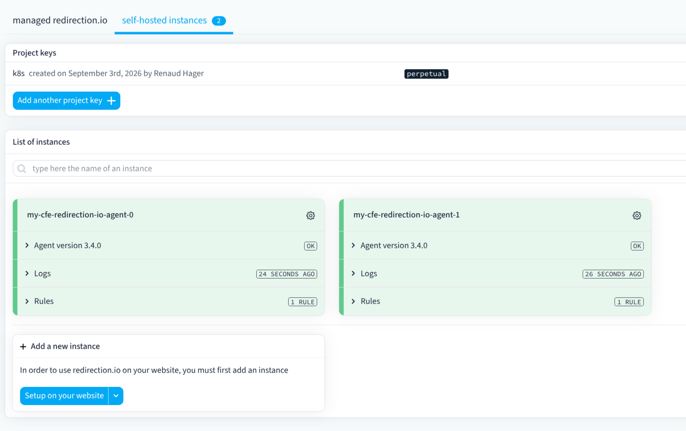

---
nav:
  title: Redirection
  position: 105
---

# Redirection management

Our platform supports redirect management through [redirection.io](https://redirection.io/) using a bring-your-own-license (BYOL) model. This is currently limited to [Composable Frontends](../composable-frontends/index.md).

## How to configure it

You first need to have an account on [redirection.io](https://redirection.io/) and a `PROJECT_KEY`.

To enable [redirection.io](https://redirection.io/) for your application you need to do the following:

- Create a secret using `sw-paas vault create` with type `env`. The key of the secret **needs** to be `REDIRECTIONIO_PROJECT_KEY`, and its value must be your `PROJECT_KEY`.

- In the `application.yaml` file add the following:

```yaml
services:
  redirectionio:
    enabled: true
Once the previous two steps are complete, you **need to trigger a new deployment to activate** [redirection.io](https://redirection.io/) on your application.

::: info
We manage the agent for you, but managing redirects is your responsibility and is not covered here. Redirects must be managed through [redirection.io](https://redirection.io/).
:::

You can check that [redirection.io](https://redirection.io/) is active in their UI (instance/self-hosted), see below:
 
