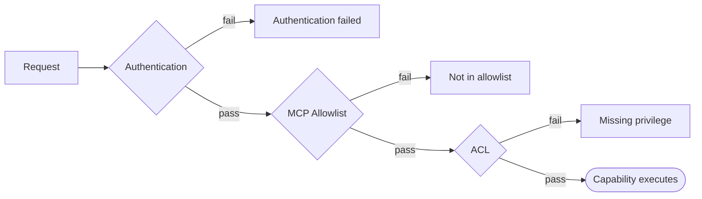

---
nav:
  title: Troubleshooting
  position: 60

---

# Troubleshooting

## Quick reference

| Symptom                                                                            | Likely cause                                                                                   | Fix                                                                                                                        |
| ---------------------------------------------------------------------------------- | ---------------------------------------------------------------------------------------------- | -------------------------------------------------------------------------------------------------------------------------- |
| `Authentication failed. Configure your MCP client...`                              | Wrong or missing credentials                                                                   | Check `sw-access-key` / `sw-secret-access-key` in your client config                                                       |
| HTTP 401 with JSON-RPC code `-32001`                                               | Bearer token missing, invalid, or expired                                                      | Send a bearer token if it is missing, otherwise get a new one; the message names the reason                                |
| `Tool "X" is not enabled in your MCP allowlist.`                                   | Tool not in the effective allowlist of the integration, the user, or both                      | Enable it under Settings → Integrations → Edit MCP Allowlist, or on the user detail page                                   |
| `Resource "X" is not enabled in your MCP allowlist.`                               | Resource not in the effective allowlist                                                        | Enable it under Settings → Integrations → Edit MCP Allowlist, or on the user detail page                                   |
| `Prompt "X" is not enabled in your MCP allowlist.`                                 | Prompt not in the effective allowlist                                                          | Enable it under Settings → Integrations → Edit MCP Allowlist, or on the user detail page                                   |
| All tool calls rejected after updating to 6.7.16.0                                 | Integration or non-admin user has no allowlist                                                 | Select capabilities, see [Per-principal allowlist](./configuration.md#per-principal-allowlist)                             |
| Resources or prompts gone after updating to 6.7.16.0                               | Allowlist stores `null` for that type                                                          | Switch **All** on again for that type, or select the capabilities, and save                                                |
| `404` for a session that worked before                                             | Session belongs to another user or integration, or was opened before 6.7.17.0                  | Send `initialize` again; sessions are bound to the principal that opened them                                              |
| OAuth token request fails with `invalid_target`                                    | Wrong `resource`, or a consent page built before 6.7.17.0 dropped it                           | Send the shop's `/api/_mcp` URL as `resource`; rebuild the Administration if the error says the grant has no resource      |
| OAuth login fails with an invalid client or redirect URI                           | Client id not registered, or redirect URI does not match exactly                               | Register the client under `shopware.api.oauth_clients`, see [OAuth issues](#oauth-issues)                                  |
| MCP client finds no OAuth metadata in a subdirectory installation                  | Well-known URIs at the host root are not rewritten                                             | Add the web server rewrites, see [Installations in a subdirectory](./configuration.md#installations-in-a-subdirectory)     |
| OAuth token gets `401` on other Admin API routes                                   | Tokens issued for the MCP resource only work on `/api/_mcp`                                    | Expected; use integration credentials for other Admin API calls                                                            |
| OAuth login works, but only three tools return nothing                             | The approving non-admin user has no MCP allowlist                                              | Select the user's capabilities on the user detail page                                                                     |
| `Missing privilege: {entity}:read`                                                 | Integration role lacks the permission                                                          | Assign an ACL role with the required privilege, or use `--admin`                                                           |
| Only three tools appear in a fresh session                                         | Expected progressive discovery behavior                                                        | Use `shopware-tool-search` or enable a toolset with `shopware-toolset-enable`                                              |
| Allowed tool missing from `tools/list`                                             | Its toolset is not enabled                                                                     | Search for the tool, enable its toolset, then refresh `tools/list`                                                         |
| Enabled toolset does not appear                                                    | Client ignored `notifications/tools/list_changed`                                              | Refresh `tools/list` manually, or connect with `?toolsets=<name>`                                                          |
| Enabled toolset never appears in claude.ai                                         | Client reads `tools/list` once per connection                                                  | Add `?toolsets=<name>` to the connection URL (6.7.15.0 and later)                                                          |
| `Invalid criteria: /aggregations/0/...`                                            | Malformed criteria, filter, or aggregation definition                                          | Fix the element named by the JSON pointer and retry                                                                        |
| No tools appear in `tools/list`                                                    | Discovery tools were removed by global `allowed_tools`                                         | Add all three discovery tools to `shopware.mcp.allowed_tools`                                                              |
| Admin integration but tool still blocked                                           | Tool is not in the integration allowlist, and an unset allowlist allows nothing since 6.7.16.0 | Admin bypasses ACL only; select the tool in the integration allowlist                                                      |
| Tool search returns every tool for an admin user                                   | Admin user login bypasses the per-user allowlist                                               | Use a non-admin user when the per-user allowlist must apply                                                                |
| `shopware-tool-search` returns nothing                                             | Query too vague; low-scoring matches are dropped                                               | Search with concrete domain wording, or list toolsets with `shopware-toolsets-list`                                        |
| `Cannot enable an MCP toolset without an active MCP session.`                      | Client did not send the `Mcp-Session-Id` header                                                | Complete the `initialize` handshake and send the returned session ID with every request                                    |
| `Invalid value for pagination parameter "cursor"`                                  | Cursor is stale, malformed, or from another principal                                          | Restart the list from the first page without a `cursor`                                                                    |
| Toolsets are forgotten between requests                                            | Session store is not shared across workers                                                     | Use a Redis session store in multi-server setups                                                                           |
| Session rejected after updating to 6.7.15.0                                        | Each server now has its own session store                                                      | Send `initialize` again to get a new session                                                                               |
| Tool missing entirely                                                              | Extension inactive or capability registration missing                                          | Check `bin/console debug:mcp`                                                                                              |
| Prompts and resources missing from `debug:mcp`                                     | Since 6.7.15.0, the command lists tools only                                                   | Run `bin/console debug:mcp --native`                                                                                       |
| `ECONNREFUSED` or "fetch failed"                                                   | Server not running or wrong URL                                                                | Start Shopware and verify the URL in your client config                                                                    |
| Client shows "Needs authentication" after failed connect                           | Client fell back to `/register` OAuth endpoint                                                 | Verify the credentials and ensure the URL ends with `/api/_mcp`                                                            |
| A tool returns `shopware://tool-result/...` instead of data                        | Result held more than about 100 KB of data and was stored                                      | Read the URI with `resources/read` within one hour, with the same credentials or `sw-context-token`, or narrow the request |
| `content[0].text` has no `success` field                                           | Since 6.7.17.0, clients on protocol `2025-06-18` or later get the plain data as text           | Read `isError` and `structuredContent`, see [Response format](./tools-reference.md#response-format)                        |
| `resources/read` of a stored result has no `success` or `_meta` field              | Since 6.7.17.0, clients on protocol `2025-06-18` or later get the plain data                   | Read the data directly, and take metadata such as `total` from the `_meta` of the tool result that sent the link           |
| `Tool result "X" not found. It may have expired or been stored by another caller.` | Link older than one hour, read by another caller, or removed by the cleanup task               | Call the tool again                                                                                                        |
| HTTP 429 `MCP endpoint throttled for N seconds.`                                   | Rate limit `mcp_admin_api` or `mcp_store_api` exceeded                                         | Wait the given time, or raise the limit, see [Rate limiting](./configuration.md#rate-limiting)                             |
| Plugin tool no longer advertised in a fresh session after updating to 6.7.16.0     | Tool declared the reserved `discovery` group and was moved to `other`                          | Give the tool its own group, and connect with `?toolsets=<group>` or enable it with `shopware-toolset-enable`              |

## Connection issues

### ECONNREFUSED or "fetch failed"

Your MCP client cannot reach the Shopware server.

1. Start the Shopware server (Docker, ddev, or your usual local setup).
2. Verify the URL in your MCP client config matches how you access the shop (host and port).
3. For local development, confirm the shop is reachable at the same URL in a browser before retrying the MCP client.

### Client shows "Needs authentication" or falls back to `/register`

Some MCP clients (e.g., Cursor) follow the OAuth 2.0 dynamic client registration flow when the primary connection fails. They automatically POST to `{server-origin}/register`, expecting a JSON error response. Shopware handles this and returns a structured error so the client can display a "Needs authentication" state instead of an opaque connection failure.

Shopware does not support dynamic client registration, also not since OAuth login was added in 6.7.17.0.
A client that should log in with OAuth needs a registered client id, see [OAuth issues](#oauth-issues).

If you use integration credentials and see this state, the root cause is in your credentials or URL, not the fallback itself:

1. Confirm your `sw-access-key` starts with `SWIA` (integration access key, not a user or sales channel key).
2. Confirm your `sw-secret-access-key` matches the secret shown when the integration was created.
3. Confirm the URL in your client config ends with `/api/_mcp` (not `/api/_action/mcp/tools` or the shop root).

## Client-specific issues

### Claude Code: "Does not adhere to MCP server configuration schema"

Claude Code requires `"type": "http"` in `.mcp.json`. The MCP spec transport name is `"streamable-http"`, which other clients accept, but Claude Code only accepts the shorter `"http"` form. Change your config:

```json
{
    "mcpServers": {
        "shopware": {
            "type": "http",
            "url": "http://localhost:8000/api/_mcp",
            "headers": {
                "sw-access-key": "SWIA...",
                "sw-secret-access-key": "..."
 }
 }
 }
}
```

## Tool registration issues

### Tool missing from `bin/console debug:mcp`

If a tool does not appear in the `debug:mcp` output, it will also be missing from the live endpoint.

**For plugin tools:**

- Confirm the plugin is installed and activated: `bin/console plugin:list`
- Confirm the service is tagged with `shopware.mcp.tool` in `services.php`
- Confirm `#[McpTool]` is on the **class**, not on `__invoke()`
- Run `bin/console cache:clear` after changes

**For core/bundle tools:**

- Confirm the service has the correct DI tag (`shopware.mcp.tool`, or `shopware.store_api_mcp.tool` for the Store API)
- Check the warning below the `debug:mcp` tool list. It names capabilities that carry an MCP attribute but that no server exposes. `bin/console debug:mcp --native` shows the same for prompts and resources.
- On 6.7.14.x and earlier, confirm the directory is listed in `scan_dirs` in `config/packages/mcp.php`. Since 6.7.15.0, capabilities are registered from their tag and `scan_dirs` no longer exists.

## Authentication issues

### HTTP 401 with JSON-RPC code `-32001`

Since Shopware 6.7.15.0, `/api/_mcp` answers a missing, invalid, or expired bearer token with HTTP 401 and the JSON-RPC error code `-32001`. The message contains the OAuth reason, for example `Missing "Authorization" header` or `Access token is expired`. Clients that support token refresh use this status to request a new token.

Before 6.7.15.0, the same cases returned HTTP 500 with the code `-32000`, which clients treated as a server outage. `/store-api/_mcp` already answered with 401.

## OAuth issues

These apply to the OAuth login of MCP clients, available since Shopware 6.7.17.0.
See [OAuth for MCP clients](./configuration.md#oauth-for-mcp-clients) for the setup.

### The client cannot find the authorization server

Check the discovery documents in a browser or with `curl`:

```bash
curl -i https://your-shop.example.com/api/_mcp
curl https://your-shop.example.com/.well-known/oauth-protected-resource/api/_mcp
curl https://your-shop.example.com/.well-known/oauth-authorization-server/api
```

- The `401` of `/api/_mcp` must carry a `WWW-Authenticate` header with `resource_metadata`.
- The URLs in the documents use the request host when it is `APP_URL` or a sales channel domain, and `APP_URL` otherwise.
  If they show `http` behind a TLS-terminating proxy, configure the trusted proxies.
- In a subdirectory installation, the well-known URIs need web server rewrites.
- The root path `/.well-known/oauth-authorization-server` is not served by Shopware.
  With `SwagAgenticCommerce` installed, it belongs to the plugin and may answer `501` while identity linking is disabled.
  MCP clients use the path form `/.well-known/oauth-authorization-server/api` and are not affected.

### The login fails with an invalid client or redirect URI

Shopware has no dynamic client registration and ships no entries for third-party MCP clients.
The client id must be configured under `shopware.api.oauth_clients`, with the exact redirect URI the client uses.
Only `http://127.0.0.1` and `http://[::1]` accept any port.
`http://localhost` must match exactly, port included, so a client like Claude Code needs a fixed callback port, for example `--callback-port 53682`.
Claude Code also refuses plain `http` OAuth endpoints on hosts other than `localhost`, `127.0.0.1`, and `::1`, so use `https` for development hosts such as `shop.localhost`.

### The token request fails with `invalid_target`

The `resource` parameter names something other than this shop's MCP endpoint.
The only accepted value is the URL of `/api/_mcp`, such as `https://your-shop.example.com/api/_mcp`.
A query and a trailing slash are ignored, but a fragment is rejected.

When the error says that the authorization was granted without a resource, the client sent `resource`, but the consent page did not forward it.
This happens with an Administration built before 6.7.17.0.
Rebuild the Administration, for example with `bin/build-administration.sh`, and log in again.

### An MCP token gets `401` on other routes

A token issued for the MCP resource works only on `/api/_mcp`.
Every other Admin API route, including `/api/_info/system-health-check`, answers it with `401`.
This is intended: a token handed to an AI client must not reach the rest of the shop.
Use integration credentials for other Admin API calls.

## Security layers

The MCP endpoint passes every request through three independent security layers. A request must clear all three before a capability executes:



**Authentication (Layer 1):** Pass `sw-access-key` and `sw-secret-access-key` headers, or a bearer token of any Admin API grant.
Obtain credentials from Settings → Integrations.
Since Shopware 6.7.17.0, MCP clients can also log in with OAuth, see [OAuth for MCP clients](./configuration.md#oauth-for-mcp-clients).

**MCP Allowlist (Layer 2):** Allowlists are scoped per principal: each integration has its own allowlist under **Settings → Integrations → Edit MCP Allowlist**, and each user has their own under **Settings → Users & Permissions → [user] → MCP tool allowlist**. An array lists the accessible capabilities of a type, and an empty array `[]` means none are accessible. Since Shopware 6.7.16.0, an unset allowlist or a `null` type also means none are accessible. Before 6.7.16.0, it meant all of them. The three server-owned discovery tools remain available, but cannot expose or enable tools denied by the effective allowlist. The `admin` flag on an integration does **not** bypass the allowlist; it only bypasses layer 3 (ACL). A rejected call is a JSON-RPC error with code `-32001` and HTTP status 200. The same code with HTTP 401 means an authentication problem instead.

Which allowlist applies depends on the auth method: integration credentials use the integration allowlist; user access keys, user bearer tokens, and OAuth logins of MCP clients use the per-user allowlist; admin user accounts (`admin = true`) bypass the allowlist entirely. When an app forwards `sw-app-user-id` alongside integration credentials (e.g., Copilot), Shopware applies the **intersection** of the integration and user allowlists.

Bearer tokens obtained through the Administration login (`client_id = administration`) resolve to the logged-in user. They use that user's allowlist, and an admin user bypasses it. Test allowlist behavior with integration credentials or with a non-admin user, never with a token copied out of the Administration session of an admin user.

The Store API endpoint has no allowlist layer at all — see [Store API MCP](./store-api.md).

**ACL (Layer 3):** Even if a capability is in the allowlist, the integration's ACL role must have the required entity-level permissions.
